# ha-utility-meter-card

[](https://www.home-assistant.io/integrations/marketplace/)
[](https://github.com/juju35/ha-utility-meter-card/actions/workflows/hacs.yml)
[](https://github.com/juju35/ha-utility-meter-card/actions/workflows/validate.yml)
[](https://github.com/juju35/ha-utility-meter-card/actions/workflows/lint.yml)
[](https://github.com/juju35/ha-utility-meter-card/releases/latest)
[](https://github.com/juju35/ha-utility-meter-card/blob/main/LICENSE)
[](https://buymeacoffee.com/julienstep9)

Lovelace cards for Home Assistant **water and gas meters**: the index, the consumption of the day, the week, the month and the year compared with the previous period, a history chart, the cost, and a **night leak detection** that raises an alert when water keeps flowing all night.

The cards work on top of the meters you already have — a pulse counter, [Gazpar / GRDF](#supported-integrations), Suez, Veolia, Eau de Paris…, or a [utility_meter](https://www.home-assistant.io/integrations/utility_meter/) helper: any `sensor` with the `water` or `gas` device class. The consumption comes from Home Assistant's **long-term statistics**, read through the `recorder/statistics_during_period` WebSocket command, so the cards show months of history without any helper to create. The drawn meter (a brass water meter on its pipe, a gas meter cabinet) is **animated by what the meter is doing**.

[](https://my.home-assistant.io/redirect/marketplace_repository/?owner=juju35&repository=ha-utility-meter-card&category=plugin)

| Water | Gas | Leak alert |
|---|---|---|
| 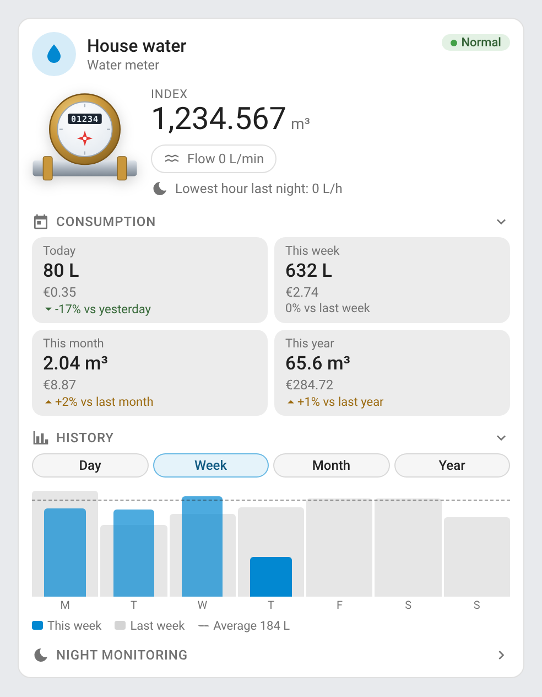 | 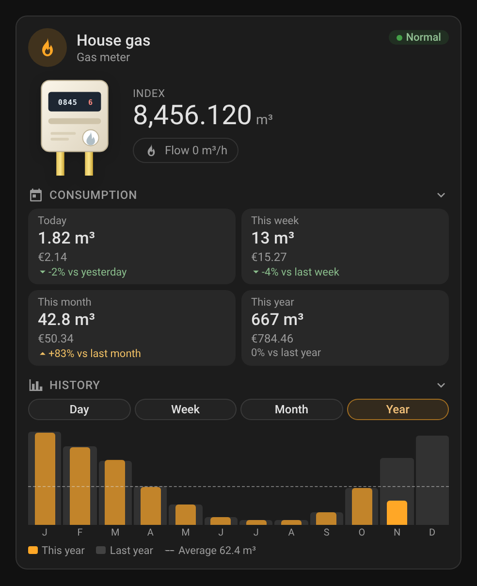 | 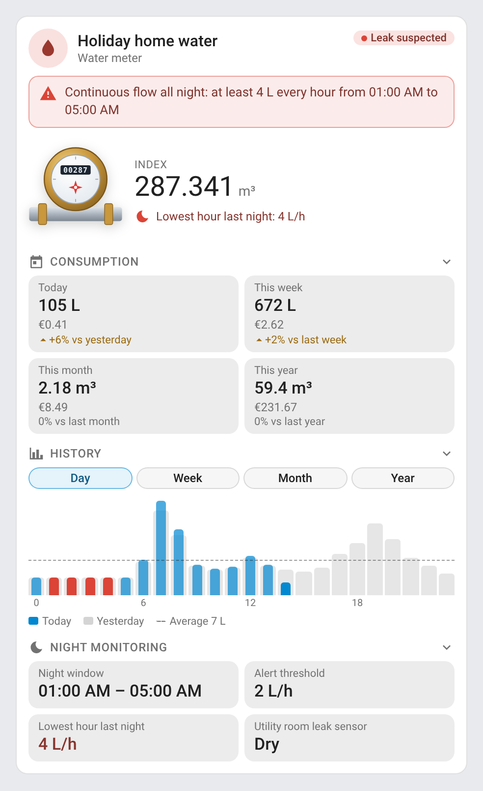 |
| 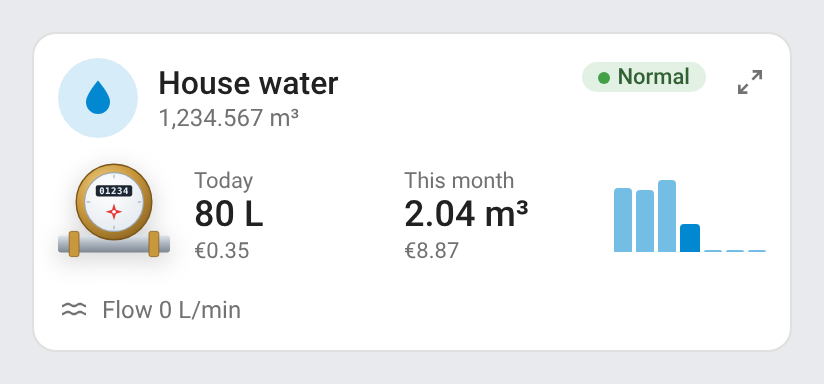 | 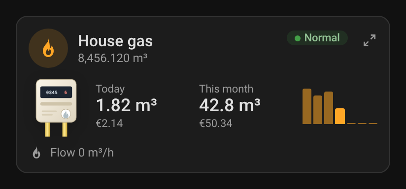 | 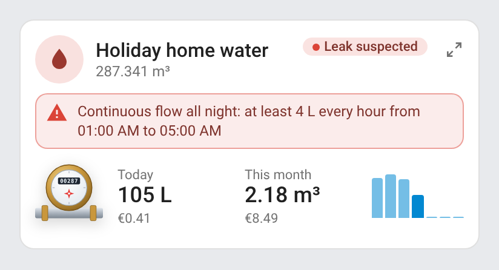 |

## Features

- Two cards: a full **Utility Meter Card** (`custom:utility-meter-card`) and a compact **Utility Meter Mini Card** (`custom:utility-meter-mini-card`)
- Water and gas meters, the kind of meter read from the sensor's device class (or forced with `meter_type`)
- **Index** of the meter, in its unit, with the meter's usual digits (three decimals for m³)
- **Consumption** of today, this week, this month and this year, from the long-term statistics, or live from a utility_meter helper fed by the meter when there is one
- **Comparison with the previous period at the same point**: today until now against yesterday until the same hour, this month so far against the same time elapsed last month… as a percentage, orange when it goes up, green when it goes down
- **History chart** of the day (hours), the week (days), the month (days) or the year (months), each bar in front of the same slot of the previous period, with the average; a click on a bar opens its details (consumption, cost, previous period) in a popup at the top of the card
- **Cost** (optional): a fixed price or a price entity, per m³ or per kWh — with a conversion factor for gas meters counting m³ — in Home Assistant's currency or your own
- **Leak detection**: water used every single hour of a night window (01:00 – 05:00 by default) above a threshold (2 L/h by default) raises an alert; a leak sensor (`binary_sensor`) and a daily limit can raise one too. The status pill turns red (orange for the daily limit), an alert banner appears and the night section unfolds
- Drawn water meter and gas meter, animated by their state (see [Animations](#animations)): water flowing, gas burning, leak
- Live flow from a flow sensor (`flow_entity`), which also drives the animation
- Header icon of the kind of meter in a tinted round badge, colored with the meter state, and a status pill on the title line
- Collapsible sections (the night section folded by default, unfolded on a suspected leak); a click anywhere else folds them back
- Sections view: the full card takes 12 columns by default and at least 6, the mini card 6; narrow widths get their own layout (see [Screenshots](#screenshots))
- Detail button on the mini card (top right): it switches the mini card to the full card's content and back; a click anywhere outside the card brings the compact view back
- Click any value to open its Home Assistant history (more-info dialog)
- Visual editor in the dashboard UI for both cards (no YAML needed)
- Light and dark mode, English, French, German, Spanish, Serbian (Cyrillic and Latin), Italian, Dutch, European Portuguese, Polish, Romanian, Danish, Swedish, Bulgarian, Russian, Ukrainian, Hungarian, Slovak, Czech, Slovenian, Latvian and Greek
- Single file, no external dependency; each language other than English is a small file loaded on demand

## Supported integrations

The cards read a cumulative `sensor` (`state_class: total` or `total_increasing`) with the `water` or `gas` device class, and its long-term statistics. Anything that provides one works, for example:

| Source | Kind | What the cards use |
|---|---|---|
| Pulse counters — [ESPHome `pulse_meter`](https://esphome.io/components/sensor/pulse_meter.html) / `pulse_counter` with a `total`, Shelly, Zigbee or Z-Wave pulse readers | Water, gas | The index sensor and its statistics; the flow sensor as `flow_entity` |
| [AI-on-the-edge-device](https://github.com/jomjol/AI-on-the-edge-device) (camera reading a meter) | Water, gas | The index sensor and its statistics |
| Gazpar / GRDF custom integrations, such as [home-assistant-gazpar](https://github.com/ssenart/home-assistant-gazpar) | Gas | The gas sensor the integration exposes (m³ or kWh), or `statistic_id` for the statistics it imports; `price_unit: energy` with the conversion factor of your bill for a price per kWh |
| [Suez Water](https://www.home-assistant.io/integrations/suez_water/) (core) and the custom integrations of other water companies (Veolia, Eau de Paris…) | Water | The water sensor; `statistic_id` for the statistics the integration imports (its daily data is a day late, so the Day tab is left out when there is no hourly data) |
| [Utility Meter](https://www.home-assistant.io/integrations/utility_meter/) helpers (core) | Water, gas | Daily, weekly, monthly and yearly helpers fed by the meter are found on their own and give the live value of their period (and their previous period when there are no statistics); `today_entity`, `week_entity`, `month_entity`, `year_entity` pick others |
| Any `binary_sensor` leak / moisture sensor | Water | `leak_entity`: raises the leak alert when it turns on |

The statistics are the ones Home Assistant keeps for every sensor with a state class (the same as the Energy dashboard's water and gas sources).

## Prerequisites

Home Assistant 2024.8 or later, the [recorder](https://www.home-assistant.io/integrations/recorder/) (on by default) and a water or gas meter sensor.

## Installation

### Via the Marketplace (recommended)

Click the button below to add the repository directly:

[](https://my.home-assistant.io/redirect/marketplace_repository/?owner=juju35&repository=ha-utility-meter-card&category=plugin)

Then click **Install**, and reload your browser when the Marketplace asks you to.

Or manually:

1. Open **Settings → Marketplace → Add from link** (top right; this needs a GitHub account connected)
2. Add `https://github.com/juju35/ha-utility-meter-card` — Type: **Dashboard**
3. Open **Utility Meter Card** and click **Install**
4. Clear your browser cache and refresh

The Marketplace adds the resource `/local/community/ha-utility-meter-card/utility-meter-card.js` for you.

### Manual

1. Download `utility-meter-card.js` and the `utility-meter-card.i18n.*.js` translation files from the [latest release](https://github.com/juju35/ha-utility-meter-card/releases/latest)
2. Copy them all to `/config/www/` (without the translation files, the cards show in English)
3. Go to **Settings → Dashboards → ⋮ → Resources** → Add resource:
   - URL: `/local/utility-meter-card.js`
   - Type: **JavaScript Module**
4. Clear your browser cache and refresh

## Configuration

### Card types

| Card | Type |
|---|---|
| Utility Meter Card | `custom:utility-meter-card` |
| Utility Meter Mini Card | `custom:utility-meter-mini-card` |

### Visual editor

Edit a dashboard, click **Add card** and search for **Utility Meter Card** or **Utility Meter Mini Card**. The first water meter is preselected (then the gas meters); pick another one in the list, set an optional title, the default chart, the sections to display, the cost, the leak detection and the data sources. The preview updates live, and options left at their default are kept out of the generated YAML.

### Minimal

```yaml
type: custom:utility-meter-card
entity: sensor.water_meter
```

```yaml
type: custom:utility-meter-mini-card
entity: sensor.gas_meter
```

### Full options

```yaml
type: custom:utility-meter-card
entity: sensor.water_meter
title: House water
meter_type: auto
chart_period: week
show_picture: true
show_index: true
show_consumption: true
show_comparison: true
show_chart: true
show_cost: true
liters: true
collapsed: [night]
# Cost
price_entity: sensor.water_price   # or price: 4.34
currency: EUR
price_unit: volume
# Leak detection
leak_detection: true
leak_start: "01:00"
leak_end: "05:00"
leak_threshold: 2
daily_limit: 0.5
flow_entity: sensor.water_flow
leak_entity: binary_sensor.utility_room_leak
# Data sources
statistic_id: sensor.water_meter
today_entity: sensor.water_daily
```

A gas meter counting m³ with a price per kWh (Gazpar):

```yaml
type: custom:utility-meter-card
entity: sensor.gazpar_index
price: 0.105
price_unit: energy
conversion_factor: 11.2
chart_period: year
```

### Options reference

| Option | Card | Default | Description |
|---|---|---|---|
| `entity` | both | First water meter, then gas meter | The meter: a `sensor` with the `water` or `gas` device class, cumulative (its index) |
| `title` | both | Entity name | Card title |
| `show_title` | both | `true` | Show the title in the header |
| `show_subtitle` | both | `true` | Show the subtitle (the kind of meter; the index on the mini card) |
| `meter_type` | both | `auto` | `auto` (from the device class), `water` or `gas`: icon, colors, drawing, liters and leak detection default |
| `show_picture` | both | `true` | Show the drawn meter, animated by its state |
| `show_index` | both | `true` | Show the index |
| `index_decimals` | both | `3` for m³, `0` for L and kWh | Decimals of the index (YAML only) |
| `show_consumption` | full | `true` | Today, this week, this month and this year |
| `show_comparison` | both | `true` | Percentage against the previous period at the same point |
| `show_chart` | both | `true` | History chart (the last days on the mini card) |
| `chart_period` | full | `week` | Chart shown first: `day`, `week`, `month` or `year` (the tabs switch it) |
| `collapsed` | full | `[night]` | Sections folded by default, among `consumption`, `history` and `night` (`[]` to unfold everything). Click a section title (or Tab to it and press Enter or Space) to fold or unfold it; a click elsewhere folds them back |
| `liters` | both | `true` | Water in m³ or L: amounts below 1 m³ in liters, from 1000 L in m³; `false` keeps the sensor's unit |
| `show_cost` | both | `true` | Show the cost when a price is set |
| `price` | both | — | Price per m³ (per the sensor's unit when it is not metric) or per kWh |
| `price_entity` | both | — | Entity holding the price, instead of `price` |
| `currency` | both | Home Assistant's | Currency code, e.g. `EUR`, `CHF` |
| `price_unit` | both | `volume` | `volume` (price per m³) or `energy` (price per kWh) |
| `conversion_factor` | both | `11.2` | kWh per m³, to price a gas meter counting m³ per kWh (or an energy meter per m³); on your gas bill |
| `leak_detection` | both | `true` for water, `false` for gas | Night leak detection |
| `leak_start` / `leak_end` | both | `01:00` / `05:00` | Night window, a continuous flow through it being a leak; it may cross midnight (`23:00` → `06:00`) |
| `leak_threshold` | both | `2` (water) / `0.05` (gas) | Lowest use per hour counted as flowing: L/h for water, the sensor's unit per hour for gas |
| `daily_limit` | both | — | Today's consumption above this (sensor's unit) shows "High usage" |
| `flow_entity` | both | — | Flow sensor (L/min, m³/h…): shown live, and drives the animation |
| `leak_entity` | both | — | Leak or moisture `binary_sensor`: its `on` state raises the leak alert |
| `statistic_id` | both | The entity's | Long-term statistic to read instead of the sensor's, e.g. one imported by Suez Water or a Gazpar integration (in a unit of the same kind as the sensor's: volume or energy) |
| `today_entity`, `week_entity`, `month_entity`, `year_entity` | both | Found on their own | utility_meter helpers giving the live value of each period |
| `zoom` | mini | `true` | Detail button at the top right of the mini card: it shows the full card's content (with the same options) and switches back to the compact view; a click outside the card also brings the compact view back. `false` removes the button |
| `language` | both | Auto | Force language: `fr`, `en`, `de`, `es`, `sr`, `sr-Latn`, `it`, `nl`, `pt`, `pl`, `ro`, `da`, `sv`, `bg`, `ru`, `uk`, `hu`, `sk`, `cs`, `sl`, `lv` or `el` (auto-detects from HA settings) |

## Screenshots

All screenshots are rendered by the repository itself with mock meters (see [Development](#development)).

### Animations

The drawn meter animates to match what it is doing and settles back to a still picture once nothing flows. Each state plays its own animation, and every one of them honours `prefers-reduced-motion`.

While water flows (the flow sensor reads more than 0, or the current hour of the statistics used water), the red star wheel of the water meter spins and water ripples along the pipe:

| Light | Dark |
|---|---|
| 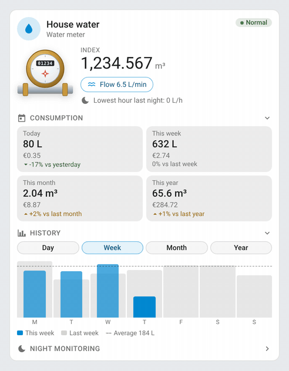 | 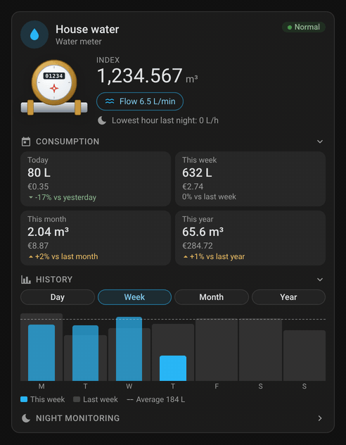 |

While gas is burning, the last digit of the gas meter rolls over and its flame flickers in orange:

| Dark | Light |
|---|---|
| 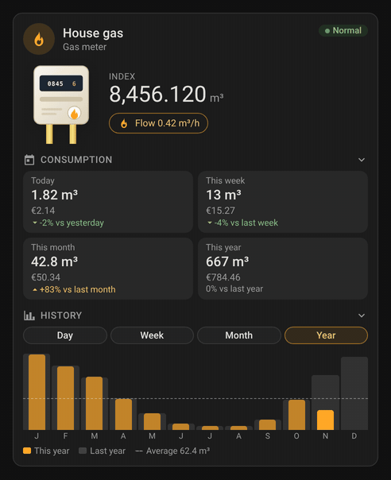 | 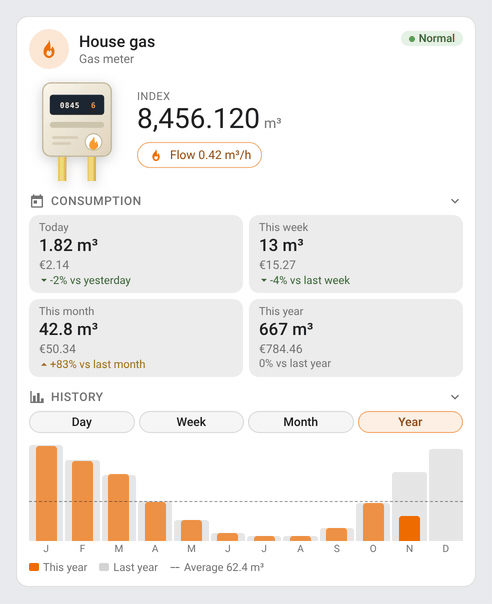 |

On a suspected leak, drops fall from the pipe joint into a growing puddle, a red ring pulses around the meter and the alert icon pulses:

| Light | Dark |
|---|---|
| 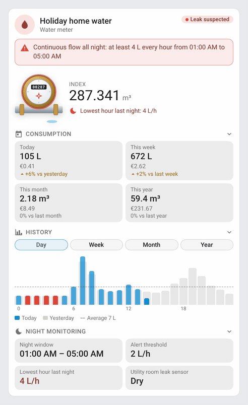 | 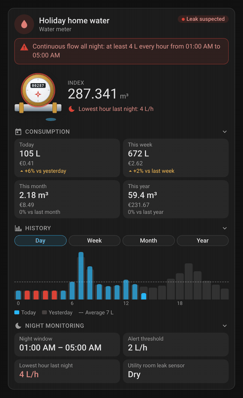 |

### Utility Meter Card

Water meter with a flow sensor and a price entity: index, the four periods with their cost and comparison, the week chart (each bar in front of the same day of last week, the dashed line is the average), the night section folded:

| Light | Dark |
|---|---|
|  |  |

Gas meter counting m³ priced per kWh, on the Year tab (this year's months in front of last year's):

| Dark | Light |
|---|---|
|  | 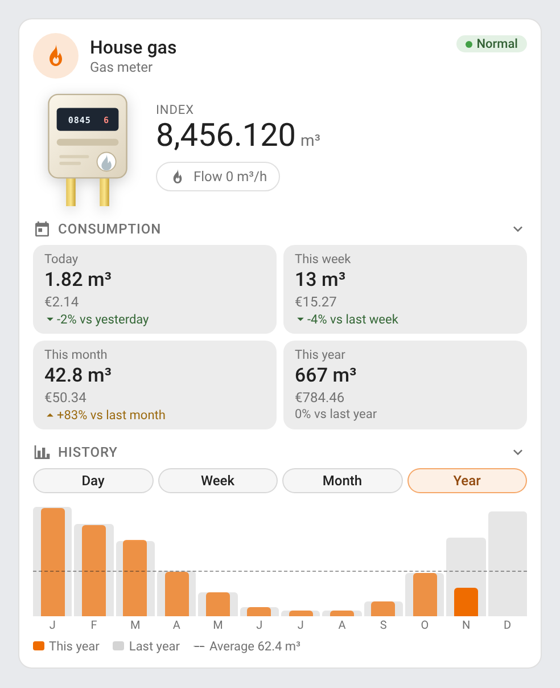 |

Leak: water kept flowing every hour of last night. The alert banner and the red status pill appear, the night hours are red in the Day chart, and the night section unfolds with the window, the threshold, last night's lowest hour and the leak sensor:

| Light | Dark |
|---|---|
|  | 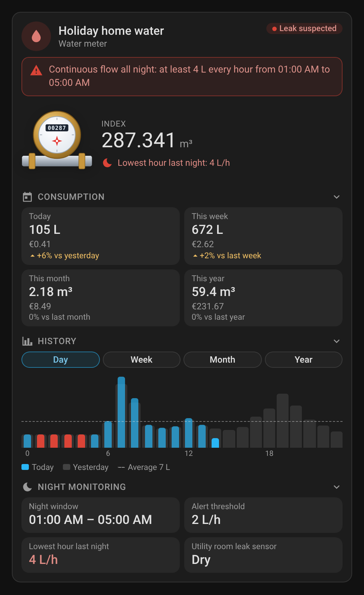 |

A click on a bar opens its details at the top of the card; the Month tab with the consumption section folded:

| Bar details (dark) | Month (light) |
|---|---|
| 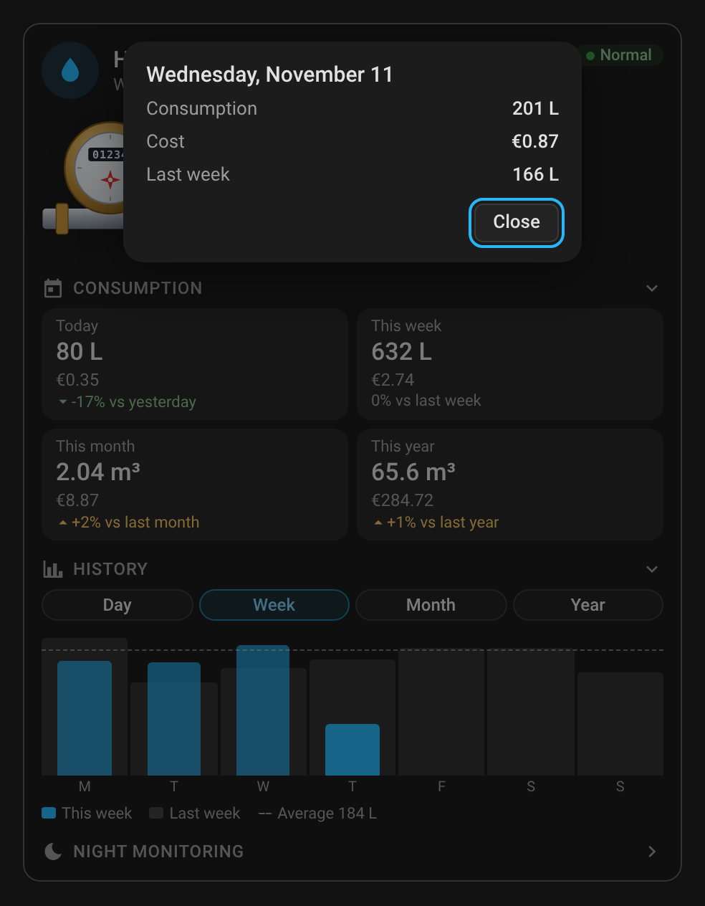 | 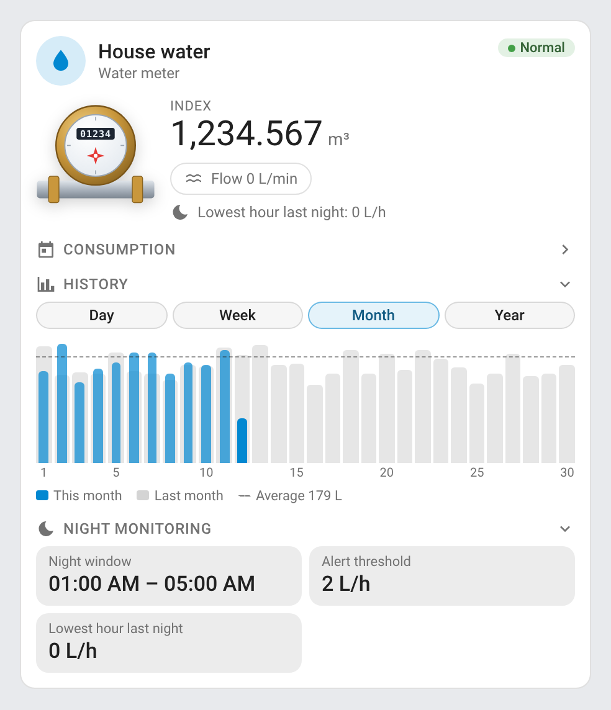 |
| 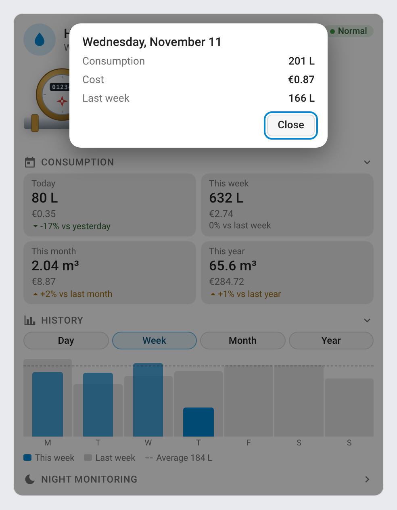 | 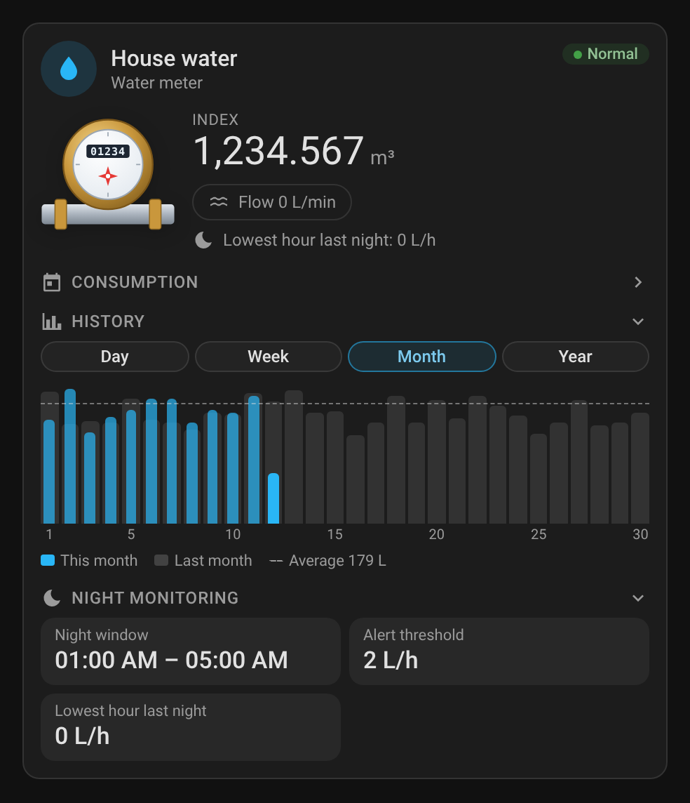 |

### Utility Meter Mini Card

Index in the subtitle, today and this month (with their cost, or the comparison without a price), the days of this week, the flow and the leak alert:

| Light | Dark |
|---|---|
|  | 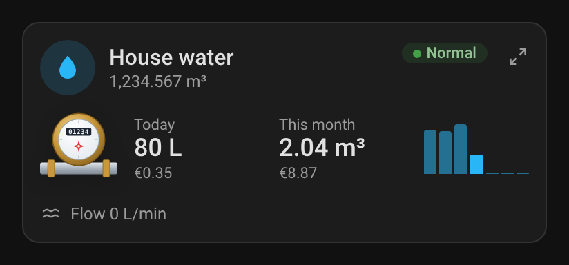 |
| 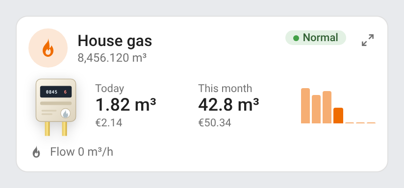 |  |
|  | 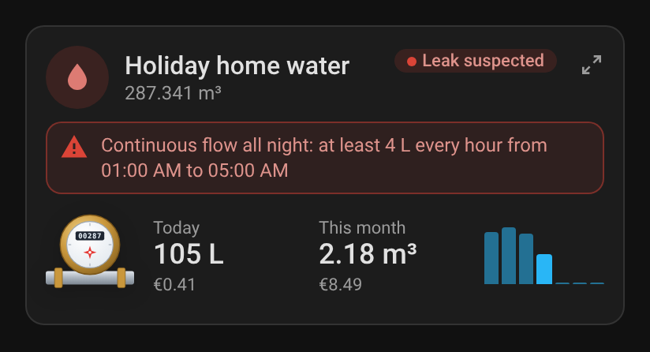 |

The detail button (top right) switches the mini card to the full card's content:

| Dark | Light |
|---|---|
| 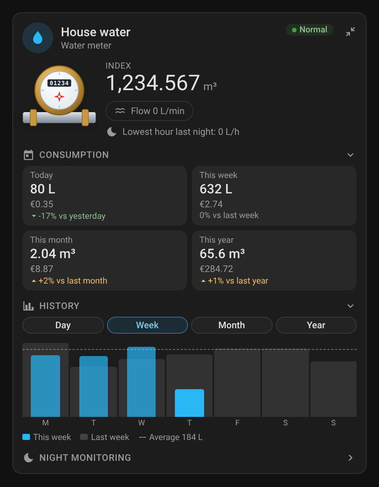 | 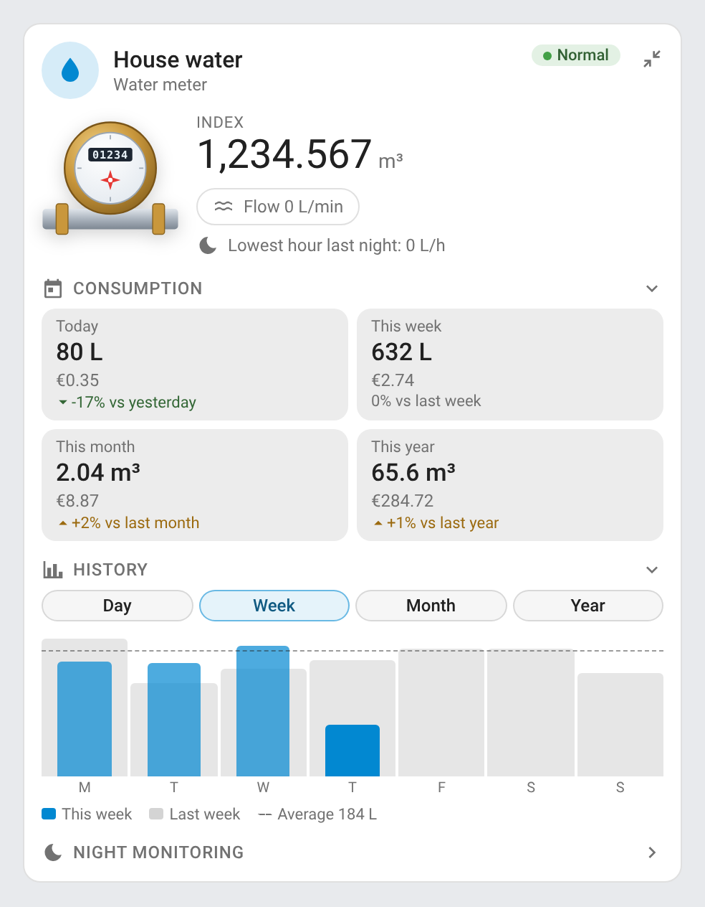 |

### Narrow cards

The full card at 238 px (the tiles take one column, the picture shrinks) and the mini card at 170 px (the status pill keeps its dot, the chart gives way):

| Full card | Mini card |
|---|---|
| 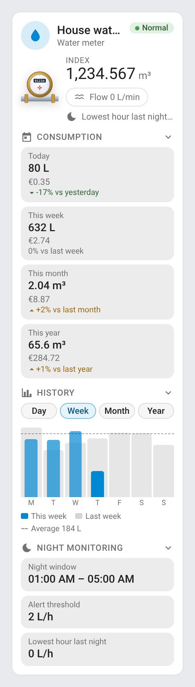 | 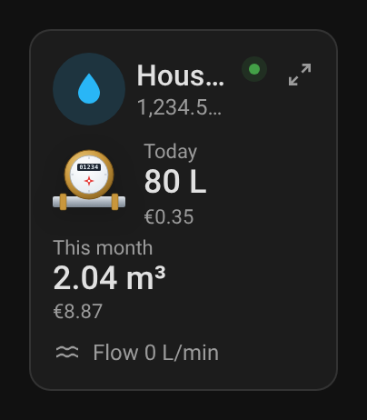 |
| 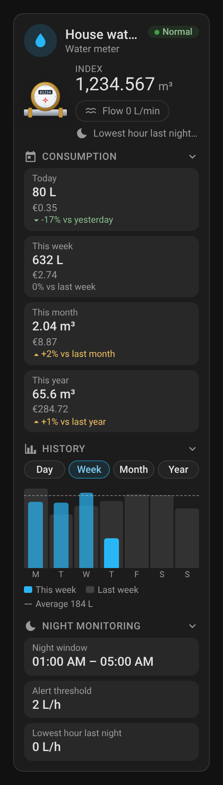 | 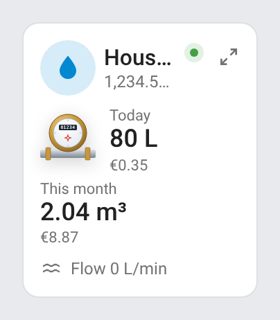 |

## How it works

### Statistics

The card asks Home Assistant for the long-term statistics of the meter (`recorder/statistics_during_period`, the `change` of each period): hourly from two days back (today, yesterday and last night) and daily from the 1st of January of last year (the weeks, months and years and the previous ones). The statistics come in the sensor's unit (an imported statistic kept in another unit of the same kind is converted by Home Assistant). Home Assistant compiles them once an hour, so the card asks again a minute into each hour and every 10 minutes (imported statistics come at any time), the daily ones at most once an hour; cards showing the same meter share the answer. Days and weeks follow the browser's time zone (the server's daily rows are placed on the browser's days) and Home Assistant's first day of the week (the language's when set to automatic).

A utility_meter helper fed by the meter (its `source` attribute) gives the live value of its period instead of the statistics; without statistics, its `last_period` attribute is the comparison. A weekly helper starts on Monday, so it is only picked on its own when the week does too (`week_entity` picks it anyway).

### Comparison

Each period so far is compared with the previous one **up to the same point**: today until 14:30 against yesterday until 14:30, this week on Thursday at 14:30 against last week until Thursday at 14:30, this month on the 12th against the same time elapsed last month (never past its end: 31 March against all of February), this year against last year. A whole previous period would always look higher early in the period. "So far" means as far as the statistics go: the last compiled hour, or the last day of an import that comes a day or two late (Suez, Gazpar), and the previous period is cut at the same point; a live utility_meter value is compared up to now.

### Leak detection

A small leak (a running toilet, a dripping tap, a broken pipe) keeps the meter turning all night, while a household uses no water for hours. The card looks at the last night window that ended (01:00 – 05:00 by default): when **every hour** of it used at least the threshold (2 L/h by default), it raises the alert, with last night's lowest hour. Widen the window or raise the threshold if a night appliance (a water softener regeneration, an irrigation program) runs in it. The alert stays until the next night window ends without a continuous flow. While the night is not in the statistics yet (hourly statistics not compiled, an import a day late, daily values only), there is no verdict.

The card can only show the alert while it is on screen: for a notification, use an automation on the same statistics or on a utility_meter helper, or on your leak sensor.

### Cost

`price` (or `price_entity`) is per m³ by default — liters are converted — and per kWh with `price_unit: energy`. A gas meter counting m³ is converted to kWh with `conversion_factor` (the kWh per m³ on your gas bill, about 11.2 in France); an energy meter priced per m³ is converted the other way. Only the consumption is priced: no subscription or fixed part.

## Development

```bash
npm install
npm run build        # bundles src/utility-meter-card.js into dist/utility-meter-card.js, translations split into dist/utility-meter-card.i18n.<lang>.js
npm run check        # builds and checks the card (run in CI)
npm test             # unit tests (TZ=UTC, fixed clock)
npm run screenshots  # renders the cards (and one GIF per animated state, needs ffmpeg) with mock data into screenshots/
```

`dist/` is not committed: `npm run build` creates it locally, CI builds it on every push, and the release workflow attaches the built files to the release, which is where the Marketplace installs it from. The screenshots are rendered on a fixed clock with mock meters and statistics (`scripts/mock-states.mjs`), and a capture is rewritten only when one of its pixels changed; the **Screenshots** workflow renders them on every pull request and commits them to the pull request's branch.

### Releasing

1. Bump `version` in `package.json` (and `npm install` to update `package-lock.json`)
2. Add a `## <version>` section at the top of [CHANGELOG.md](https://github.com/juju35/ha-utility-meter-card/blob/main/CHANGELOG.md)
3. Push to `main`: the **Release** workflow builds the card, creates the tag and the GitHub release with the changelog section as notes, and attaches `utility-meter-card.js` and its translation files

## Translations

The cards auto-detect the language from your Home Assistant settings. Currently supported:

| Language | Code |
|---|---|
| English | `en` |
| Français | `fr` |
| Deutsch | `de` |
| Español | `es` |
| Српски | `sr` |
| Srpski (latinica) | `sr-Latn` |
| Italiano | `it` |
| Nederlands | `nl` |
| Português (European; also used for `pt-BR`) | `pt` |
| Polski | `pl` |
| Română | `ro` |
| Dansk | `da` |
| Svenska | `sv` |
| Български | `bg` |
| Русский | `ru` |
| Українська | `uk` |
| Magyar | `hu` |
| Slovenčina | `sk` |
| Čeština | `cs` |
| Slovenščina | `sl` |
| Latviešu | `lv` |
| Ελληνικά | `el` |

Contributions for additional languages are welcome!

## License

[MIT](https://github.com/juju35/ha-utility-meter-card/blob/main/LICENSE)

## Support

If you find this project useful, you can support its development:

<a href="https://buymeacoffee.com/julienstep9"></a>
